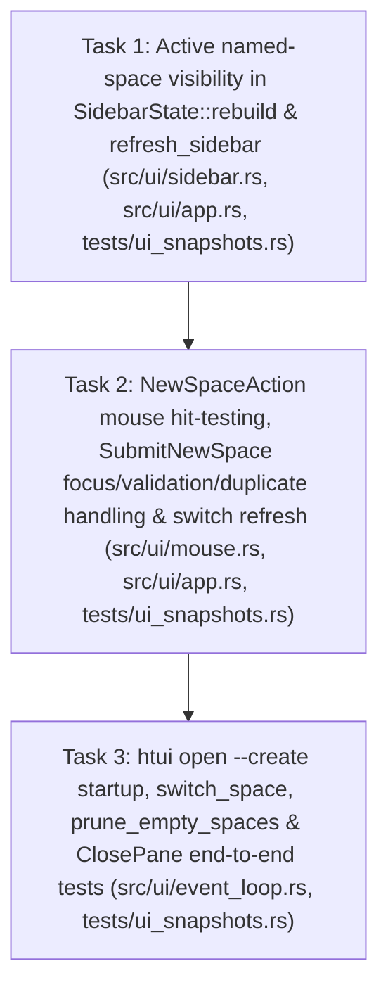

# Implementation Plan: Show Active Empty Named Space in Sidebar & Harden New-Space Flow

> **Note:** The prior completed plan and task list (`Command::ClosePane` & Empty Spaces) have been archived to [closepane-empty-spaces-plan.md](file:///home/tawargy/Documents/0-WorkSpace/1-SideProjects/htui/.orca/arch/closepane-empty-spaces-plan.md) and [closepane-empty-spaces-todo.md](file:///home/tawargy/Documents/0-WorkSpace/1-SideProjects/htui/.orca/arch/closepane-empty-spaces-todo.md).

## Overview
In the prior change, `SidebarState::rebuild` (`src/ui/sidebar.rs:67-120`) was updated to skip every `SpaceNode` with `sp.terminals.is_empty()`. Because `rebuild` does not know which space is currently active, creating a new named space via `Ctrl+b c`, `[+ New Space]`, or `htui open <space> --create` immediately hides that newly created active space from `sidebar.visible_items` until a terminal is spawned in it, making space creation appear broken to users.

This plan updates `SidebarState::rebuild` to accept `active_space: Option<&str>` so the active named space (`!= UNASSIGNED_SPACE`) is immediately visible in `sidebar.visible_items` even with 0 terminals, while empty `(unassigned)` and inactive empty spaces remain hidden and continue to be pruned cleanly on space switch, `Command::ClosePane`, and `Command::Quit`. It also fixes edge cases discovered in the `[+ New Space]` / `SubmitNewSpace` / `switch_space` / startup flow (sidebar border clicks in `src/ui/mouse.rs`, post-submit focus & selection in `src/ui/app.rs`, `UNASSIGNED_SPACE` guard in `SubmitNewSpace`, unconditional `refresh_sidebar()` after space switches, and offline startup sidebar initialization in `src/ui/event_loop.rs`).

---

## Architecture Decisions

1. **Active-Space-Aware Filtering in `SidebarState::rebuild` (`src/ui/sidebar.rs`, `src/ui/app.rs`):**
   - Change `SidebarState::rebuild(&mut self, tree: &[MachineNode])` (`src/ui/sidebar.rs:67`) to `pub fn rebuild(&mut self, tree: &[MachineNode], active_space: Option<&str>)`.
   - In the per-space loop (`src/ui/sidebar.rs:81-89`), show a `SpaceNode` if `!sp.terminals.is_empty()` OR `(m.is_local && active_space == Some(sp.name.as_str()) && sp.name != UNASSIGNED_SPACE)`:
     - Active named space (`!= UNASSIGNED_SPACE`) with 0 visible terminals renders as `SidebarItem::Space { machine, name, count: 0 }`.
     - Empty `UNASSIGNED_SPACE` is ALWAYS skipped, even when `active_space == Some(UNASSIGNED_SPACE)`.
     - Inactive empty spaces (`sp.name != active_space`, 0 visible terminals — including `show_finished == false` spaces when inactive) remain hidden.
   - Update `TuiApp::refresh_sidebar` (`src/ui/app.rs:169`) to call `self.sidebar.rebuild(&tree, Some(&self.active_space))`.
   - Keep `AppModelState::build_tree` (`src/model/reducer.rs:197-274`) untouched so `ST-2` in `tests/model.rs` continues to pass.

2. **Harden `[+ New Space]` Click, `SubmitNewSpace`, and Space-Switch Refresh (`src/ui/mouse.rs`, `src/ui/app.rs`):**
   - **Sidebar inner hit-testing (`src/ui/mouse.rs:88-105`):** Use `pane_inner(spaces_area)` and `pane_inner(agents_area)` (checking `inner.width > 0 && inner.height > 0 && rect_contains(inner, col, row)`) before returning `MouseAction::SelectSidebarRow`, so clicking the `" Spaces "` / `" Agents "` box border (e.g., `row == spaces_area.y`) returns `MouseAction::None` instead of saturating to `idx: 0` (`NewSpaceAction`).
   - **`SubmitNewSpace` validation, focus, and selection (`src/ui/app.rs:293-303`):**
     - Trim `name` defensively; if `name.is_empty() || name == UNASSIGNED_SPACE`, set an informational/error toast (`"Invalid space name"`) and do NOT insert into `declared_spaces` or emit `AppAction::SaveLayout(UNASSIGNED_SPACE)`.
     - For valid names: clear `self.sidebar_focused = false` (important when triggered via mouse click on `[+ New Space]` or Enter in sidebar so focus moves to the new space's pane), insert into `declared_spaces`, call `switch_space` (which preserves existing `layouts.spaces` entry if the space name already exists, avoiding clobbering duplicate space names), call `refresh_sidebar()`, and move `self.sidebar.selected` (with `SidebarPanel::Spaces`) to the created/switched space item in `visible_items`.
   - **Refresh sidebar on all `switch_space` paths (`src/ui/app.rs:365-375, 544-568`):** Call `self.refresh_sidebar()` unconditionally after `self.switch_space(...)` when selecting `SidebarItem::Space` or `SidebarItem::Terminal` (not only `if let Some(removed)`), so switching away from an active space that had 0 visible terminals (e.g. `show_finished == false` with an attached finished terminal) immediately hides that now-inactive space. Keep `self.sidebar_focused` unchanged on `SidebarItem::Space` selection so keyboard sidebar navigation continues to work.

3. **Startup (`htui open <space> --create`), Pruning, and `ClosePane` Lifecycle (`src/ui/event_loop.rs`, `tests/ui_snapshots.rs`):**
   - In `run_tui_loop` (`src/ui/event_loop.rs:114-117`), call `app.refresh_sidebar()` when `EventStream::subscribe` fails on startup so `[+ New Space]` and any `initial_space` (`--create`) are visible immediately even while disconnected.
   - Verify `reconcile_startup_layouts` (`src/ui/event_loop.rs:247-360`), `switch_space`, `prune_empty_spaces`, `Command::ClosePane`, and `Command::Quit` keep the active empty named space visible until the user switches away, closes its last pane, or quits — and keep empty `UNASSIGNED_SPACE` hidden throughout.

---

## Dependency Graph

---

## Task List

### Phase 1: Core Sidebar Active-Space Visibility
- [ ] Task 1: Pass `active_space` to `SidebarState::rebuild` so active empty named spaces appear (`count: 0`) while empty `(unassigned)` and inactive empty spaces stay hidden (`src/ui/sidebar.rs`, `src/ui/app.rs`, `tests/ui_snapshots.rs`)

### Checkpoint: Sidebar Visibility Verified
- [ ] `cargo test --test model && cargo test --test ui_snapshots` pass
- [ ] `cargo check --all-targets` succeeds with zero warnings

### Phase 2: `[+ New Space]` Click, `SubmitNewSpace`, and Lifecycle Hardening
- [ ] Task 2: Fix sidebar border click hit-testing, `SubmitNewSpace` invalid-name/focus/selection/duplicate-space handling, and unconditional `refresh_sidebar()` on `SidebarItem::Space`/`Terminal` switch (`src/ui/mouse.rs`, `src/ui/app.rs`, `tests/ui_snapshots.rs`)
- [ ] Task 3: Ensure disconnected startup initializes sidebar, and verify `htui open <space> --create`, `switch_space`, `prune_empty_spaces`, `Command::ClosePane`, and `Command::Quit` lifecycle end-to-end (`src/ui/event_loop.rs`, `tests/ui_snapshots.rs`)

### Checkpoint: Complete
- [ ] All acceptance criteria met
- [ ] `cargo fmt --all -- --check`, `cargo clippy --all-targets -- -D warnings`, and `cargo test --all-targets` pass cleanly

---

## Risks and Mitigations

| Risk | Impact | Mitigation |
|------|--------|------------|
| Changing `SidebarState::rebuild` signature breaks existing unit tests in `tests/ui_snapshots.rs` | Low | Update all 3 direct `sb.rebuild(&tree)` call sites in `tests/ui_snapshots.rs` (lines 62, 124, 447) in Task 1 |
| `sidebar_rebuild_hides_empty_and_finished_only_spaces` (`tests/ui_snapshots.rs:461-485`) creates `TuiApp::new(cfg, Some("jobs".into()))` where `"jobs"` is active and expects `"jobs"` hidden when `show_finished == false` | Med | Clarify the test to verify an *inactive* finished-only space (`"jobs"` with `t-fin` attached while `active_space` is `UNASSIGNED_SPACE` or `"api"`) stays hidden when `show_finished == false` and reappears when `show_finished == true`, while an *active* `"jobs"` shows `count: 0` and hides upon switching away |
| Clearing `sidebar_focused` on `SidebarItem::Space` click/Enter would break keyboard sidebar navigation (`sidebar_new_space_at_index_zero_and_keyboard_nav` at `tests/ui_snapshots.rs:545-578`) | High | Only clear `self.sidebar_focused = false` on `DialogOutcome::SubmitNewSpace` and `SidebarItem::Terminal`, keeping `sidebar_focused` unchanged when switching via `SidebarItem::Space` |
| `tests/ui_snapshots.rs::new_space_shortcut_and_spawn_unassigned` and `reconcile_startup_layouts_cleans_stale_and_unassigned_while_preserving_create` currently assert empty active spaces are absent from `sidebar.visible_items` | Med | Update both tests using TDD first so they assert the active named space (`"backend"` / `"new-space"`) IS immediately present with `count: 0` while empty `UNASSIGNED_SPACE` and inactive/stale spaces stay hidden |
