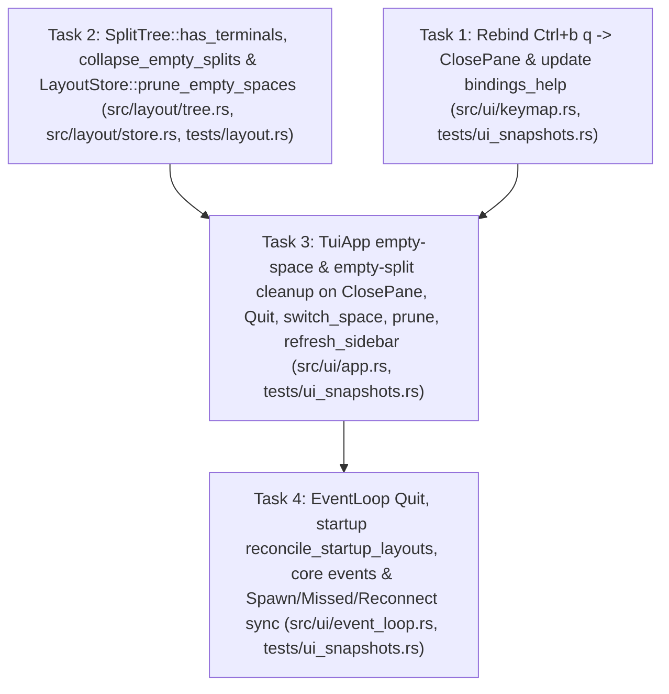

# Implementation Plan: `Ctrl+b q` ClosePane Rebinding & Empty Space / Empty Split Cleanup

## Overview
Currently in `htui`, `Ctrl+b q` is bound to `Command::Quit` alongside `Ctrl+b d`, while `Command::ClosePane` is only bound to `Ctrl+b x`. Additionally, empty spaces (spaces containing only empty panes and no live/open terminals) and empty split panels (such as split panes in `(unassigned)` or spaces left behind after `Quit`, `switch_space`, `refresh_sidebar`, `Missed`/reconnect snapshots, `ClosePane`, or core `finished`/`removed`/`labels` events) can remain in `layouts.spaces`, `model.declared_spaces`, and persisted `htui.layout` in `LayoutStore` across restarts. This plan rebinds `Ctrl+b q` to `Command::ClosePane` (keeping `Ctrl+b x` for `ClosePane` and `Ctrl+b d` for `Quit`) and enforces consistent cleanup of empty spaces and empty split panels across all lifecycle paths while protecting newly created active spaces (`Ctrl+b c` and `htui open <space> --create`) until the user spawns, switches away, closes, or quits.

---

## Architecture Decisions

1. **Keymap Rebinding (`src/ui/keymap.rs`):**
   - Route `KeyCode::Char('x') | KeyCode::Char('q') => RouteResult::Command(Command::ClosePane)` and `KeyCode::Char('d') => RouteResult::Command(Command::Quit)` in `PrefixRouter::route`.
   - Update `PrefixRouter::bindings_help()` to display `("Ctrl+B x / q", "Close focused pane")` and `("Ctrl+B d", "Detach and quit htui")`.
   - Keep `KeyCode::Char('q')` inside `HelpDialog::handle_key` (`src/ui/dialogs/help.rs`) as a modal close key, and keep `src/ui/statusbar.rs` (`Ctrl+B ? Help | Ctrl+B d Quit`) unchanged.

2. **Pure `SplitTree` Primitives (`src/layout/tree.rs`):**
   - Add `pub fn has_terminals(&self) -> bool` returning `true` iff any `SplitNode::Leaf` has `terminal.is_some()`.
   - Add `pub fn collapse_empty_splits(&mut self) -> bool` which, when `!self.has_terminals()` and `self.pane_ids().len() > 1`, collapses the tree into a single empty `SplitNode::Leaf { id: first_id, terminal: None }` and returns `true` (preserving `SplitTree::prune_removed` behavior when at least one terminal remains, as required by `split_close_resize_and_navigate` in `src/layout/tree.rs`).

3. **Atomic Empty-Space Pruning in `LayoutStore` (`src/layout/store.rs`):**
   - Add `pub async fn prune_empty_spaces(&self, rpc: Option<&RpcClient>, removed_spaces: &HashSet<String>) -> HcResult<u64>` using `self.mutate_doc` (single CAS `doc.get`/`doc.set` + local `layout.json` fallback) to retain only spaces where `!removed_spaces.contains(sp) && tree.has_terminals()`.
   - Because `UNASSIGNED_SPACE` (`"(unassigned)"`) with only empty panes has `!tree.has_terminals()`, it is also removed from persisted `htui.layout` so empty panels do not reopen across restarts.

4. **Protecting Newly Created Active Spaces While Cleaning All Other Empty Paths (`src/ui/app.rs` & `src/ui/event_loop.rs`):**
   - *Active New-Space Protection:* When a user creates a space via `Ctrl+b c` (`DialogOutcome::SubmitNewSpace`) or `htui open <space> --create` (`initial_space_name`), it becomes `self.active_space` with 1 empty pane (`SplitTree::with_single(None)`). Background `refresh_sidebar()` calls (e.g., from unrelated status events) MUST NOT delete `self.active_space` when `pruned_count == 0`.
   - *When Empty Spaces & Empty Splits ARE Cleaned:*
     - **`switch_space`:** Leaving a `prev` space that has no open terminals (`!self.space_has_open_terminals(&prev)`, or `!tree.has_terminals()` for `UNASSIGNED_SPACE`) removes `prev` from `layouts.spaces` & `model.declared_spaces` and returns `Some(prev)` so callers emit `AppAction::RemoveLayout(prev)` or call `store.remove_space`.
     - **`Command::ClosePane`:** Closing the last terminal or last empty pane of a named space removes the space (`remove_empty_space` + `AppAction::RemoveLayout`) without showing `"Cannot close last pane"`. In `UNASSIGNED_SPACE`, if `!current_tree().has_terminals()`, collapses any empty splits and emits `AppAction::RemoveLayout(UNASSIGNED_SPACE)` (instead of `SaveLayout`) whenever `had_multi || closed_addr.is_some()`.
     - **`Command::Quit` & `AppAction::Quit`:** `Command::Quit` removes all spaces without terminal panels (including `UNASSIGNED_SPACE` if `!tree.has_terminals()`) from `self.layouts.spaces` and `self.model.declared_spaces` while still returning `vec![AppAction::Quit]` (preserving `tests/ui_snapshots.rs::app_lifecycle`). `dispatch_action(AppAction::Quit, ...)` also invokes `app.cleanup_empty_spaces_on_quit()` and `store.prune_empty_spaces(rpc, &removed).await` so `htui.layout` and `layout.json` never retain empty spaces or empty split panels across restarts.
     - **`refresh_sidebar`, `handle_core_event`, `AppAction::Kill`, `AppAction::Remove`, `Missed`, Reconnect:** Prune missing terminals (`prune_removed`) and unbind any `TermRef` whose terminal in `model.terminals` now carries a different `space_name()` (e.g., via `"labels"` event). Collapse empty splits when `!tree.has_terminals()` and `pruned > 0` (or non-active), remove non-active empty spaces (and active spaces whose terminals were pruned `pruned > 0`), and sync removals to `LayoutStore`. Keep `AppModelState`'s pure `apply()` reducer unchanged (preserving `ST-2` in `tests/model.rs`).
     - **Startup (`reconcile_startup_layouts` in `src/ui/event_loop.rs`):** Extract startup layout pruning from `run_tui_loop` into `pub async fn reconcile_startup_layouts(...)`: prune dead terminals against `snap.terminals`, collapse empty splits on `initial_space_name` and `UNASSIGNED_SPACE`, remove all non-`initial_space_name` spaces without live terminals/terminal panels from `app` and `LayoutStore` (including `UNASSIGNED_SPACE` from `LayoutStore` when `!tree.has_terminals()`), re-save any remaining non-empty space whose tree had dead terminals pruned, and ensure `app.active_space` has a valid single-pane tree and `focused_pane`.

---

## Dependency Graph

---

## Task List

### Phase 1: Keymap & Layout Foundations
- [x] Task 1: Rebind `Ctrl+b q` to `Command::ClosePane` and update `bindings_help()` (`src/ui/keymap.rs`, `tests/ui_snapshots.rs`)
- [x] Task 2: Add `SplitTree::has_terminals`, `SplitTree::collapse_empty_splits`, and `LayoutStore::prune_empty_spaces` (`src/layout/tree.rs`, `src/layout/store.rs`, `tests/layout.rs`)

### Checkpoint: Keymap & Layout Primitives Verified
- [x] `cargo test --lib ui::keymap`, `cargo test --lib layout::tree`, and `cargo test --test layout` pass
- [x] `cargo check --all-targets` succeeds with zero warnings

### Phase 2: Application & Event Loop Lifecycle Cleanup
- [x] Task 3: Enforce empty-space & empty-split cleanup in `TuiApp` (`ClosePane`, `Quit`, `switch_space`, `prune_terminal_from_spaces`, `refresh_sidebar`) (`src/ui/app.rs`, `tests/ui_snapshots.rs`)
- [x] Task 4: Wire `AppAction::Quit`, startup `reconcile_startup_layouts`, `handle_core_event`, `Missed`/reconnect, and `Spawn` persistence cleanup (`src/ui/event_loop.rs`, `tests/ui_snapshots.rs`)

### Checkpoint: Complete
- [x] All acceptance criteria met
- [x] `cargo test --all-targets`, `cargo fmt --all -- --check`, and `cargo clippy --all-targets -- -D warnings` pass cleanly

---

## Risks and Mitigations

| Risk | Impact | Mitigation |
|------|--------|------------|
| `Command::Quit` emitting extra `AppAction::RemoveLayout` breaks `tests/ui_snapshots.rs::app_lifecycle` (`assert_eq!(actions, vec![AppAction::Quit])`) | High | Clean `TuiApp` in-memory `layouts.spaces` & `declared_spaces` in `Command::Quit` while returning `vec![AppAction::Quit]`, and perform `LayoutStore::prune_empty_spaces` in `dispatch_action(AppAction::Quit)` |
| `refresh_sidebar()` triggered by background core events deletes a newly created empty space (`Ctrl+b c` or `htui open <space> --create`) before the user spawns | High | Preserve `self.active_space` in `refresh_sidebar()` when `pruned_count == 0`; only delete `self.active_space` in `refresh_sidebar()` if `pruned_count > 0` (its terminal exited/vanished) |
| Modifying `AppModelState::apply` reducer to drop `declared_spaces` breaks `tests/model.rs` (`ST-2`) | High | Keep `src/model/reducer.rs` untouched and perform empty-space cleanup in `TuiApp` and `event_loop.rs` |
| Existing unit tests in `tests/ui_snapshots.rs` attach mock `TermRef`s to `SplitTree` without populating `model.terminals` | Med | Do not call `refresh_sidebar()` inside those tests, and only unbind `TermRef`s by label mismatch when `model.terminals.get(addr)` exists with a different `space_name()` |
| `UNASSIGNED_SPACE` split panes (`[empty1 | empty2]`) persist in `htui.layout` and reopen on next startup | Med | Collapse `!tree.has_terminals()` trees via `collapse_empty_splits()`, emit `RemoveLayout(UNASSIGNED_SPACE)` on `ClosePane`/`switch_space` when empty, and strip `!tree.has_terminals()` spaces (including `UNASSIGNED_SPACE`) in `LayoutStore::prune_empty_spaces` and `reconcile_startup_layouts` |
