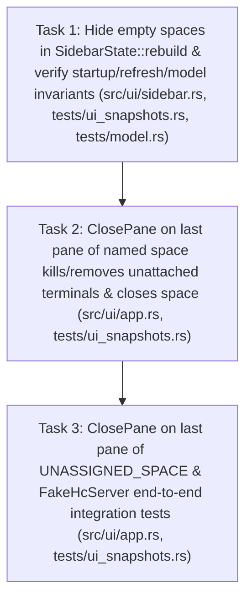

# Implementation Plan: `Command::ClosePane` Closes Spaces (Even on Empty Last Pane), Kills/Removes Unattached Terminals, and Hides Empty Spaces from Sidebar

## Overview
Currently in `htui`, `Command::ClosePane` (`Ctrl+b q` / `Ctrl+b x` in `src/ui/app.rs`) only kills/removes the terminal attached to the focused pane (`closed_addr`). When `ClosePane` runs on a space's last `(empty)` pane (`!had_multi && closed_addr.is_none()`):
1. In a named space (`cur_space != UNASSIGNED_SPACE`) that has unattached terminals in `self.model.terminals` (e.g. spawned externally or unattached after switching into the space), `space_has_open_terminals(&cur_space)` returns `true`, so `ClosePane` emits `"Cannot close last pane"` instead of closing the unattached terminals and removing the space.
2. In `UNASSIGNED_SPACE` when `!had_multi`, `ClosePane` neither kills/removes unattached unassigned terminals nor switches away from `UNASSIGNED_SPACE` when another non-unassigned space exists in `self.layouts.spaces`, instead showing `"Cannot close last pane"`.
3. In `src/ui/sidebar.rs` (`SidebarState::rebuild`), every `SpaceNode` in `AppModelState::build_tree` is rendered as a `SidebarItem::Space` even when `sp.terminals.is_empty()` (`count == 0`) — e.g. newly created empty spaces (`Ctrl+b c` / `htui open --create`), spaces whose only terminals are finished when `show_finished == false`, or declared empty spaces.

This plan hides empty spaces (`sp.terminals.is_empty()`) from the sidebar while preserving `AppModelState::build_tree` (`ST-2` in `tests/model.rs`), updates `Command::ClosePane` on a space's last pane to kill/remove any unattached terminals belonging to that space and close/switch spaces cleanly, and verifies everything with unit and `FakeHcServer` + `LayoutStore` integration tests.

---

## Architecture Decisions

1. **Hide Empty Spaces in `SidebarState::rebuild` While Preserving `AppModelState::build_tree` (`src/ui/sidebar.rs`, `src/model/reducer.rs`, `src/ui/app.rs`):**
   - Keep `AppModelState::build_tree` (`src/model/reducer.rs:197-274`) preserving `declared_spaces` with `terminals: vec![]` so `ST-2` in `tests/model.rs` (`assert!(local2.spaces.contains_key("api")); assert_eq!(local2.spaces["api"].terminals.len(), 0);`) remains valid.
   - Update `SidebarState::rebuild` (`src/ui/sidebar.rs:81-86`) to skip any `SpaceNode` where `sp.terminals.is_empty()`. This guarantees zero-terminal spaces never appear in `sidebar.visible_items` (including active newly-created `Ctrl+b c` / `--create` spaces before spawning, spaces whose only terminals are finished when `show_finished == false`, and `(unassigned)` when empty).
   - Keep active-space protection in `TuiApp::prune_empty_spaces` (`src/ui/app.rs:1071-1150`) and `TuiApp::refresh_sidebar` (`src/ui/app.rs:159-171`) so an active newly-created space (`Ctrl+b c` or `htui open <space> --create`) remains in `layouts.spaces` and `declared_spaces` until the user spawns into it, switches away, closes it, or quits — while remaining hidden from the sidebar until it holds at least one visible terminal.
   - Update `tests/ui_snapshots.rs::new_space_shortcut_and_spawn_unassigned` so submitting `"backend"` via `Ctrl+b c` asserts `app.active_space == "backend"`, `app.layouts.spaces.contains_key("backend")`, and `AppAction::SaveLayout("backend")`, while `"backend"` stays absent from `app.sidebar.visible_items` until a terminal in `"backend"` is added.

2. **Shared Terminal Cleanup Helpers on `TuiApp` (`src/ui/app.rs`):**
   - Extract small private helpers on `TuiApp`:
     - `kill_or_remove_terminal(&mut self, addr: &str, actions: &mut Vec<AppAction>)`: inspects `self.model.terminals.get(addr)` (`is_live()` or unknown -> `Kill` + `Remove`, `!is_live()` -> `Remove`), removes `addr` from `self.sessions` and `self.model.terminals`, and pushes the corresponding `AppAction`s.
     - `close_space_terminals(&mut self, space: &str, actions: &mut Vec<AppAction>) -> usize`: finds all addresses in `self.model.terminals` where `TerminalEntry { terminal: t.clone() }.space_name() == space`, sorts them lexicographically for deterministic action ordering, calls `kill_or_remove_terminal` for each, and returns the count closed.
   - Make fallback next-space selection deterministic across `remove_empty_space`, `prune_empty_spaces`, and `Command::ClosePane` by using `.filter(|k| k.as_str() != UNASSIGNED_SPACE).min().cloned()` on `self.layouts.spaces.keys()` (matching sidebar `BTreeMap` order rather than random `HashMap` iteration).

3. **`Command::ClosePane` Last-Pane Behavior for Named Spaces (`src/ui/app.rs`):**
   - When `!had_multi` (closing the space's last pane, whether `closed_addr` is `Some` or `None`) and `cur_space != UNASSIGNED_SPACE`:
     - Handle `closed_addr` (if `Some`) via `kill_or_remove_terminal`.
     - Call `close_space_terminals(&cur_space, actions)` so any unattached live or finished terminals belonging to `cur_space` are killed+removed / removed and purged from `self.model.terminals` and `self.sessions`.
     - Remove `cur_space` via `self.remove_empty_space(&cur_space)` (which removes it from `declared_spaces` & `layouts.spaces` and switches `active_space` to another named space if available, or `UNASSIGNED_SPACE`).
     - Emit `AppAction::RemoveLayout(cur_space)` and never emit `"Cannot close last pane"`.
   - When `had_multi == true` in a named space: close `pid`, refocus a remaining pane, remove `cur_space` + emit `RemoveLayout(cur_space)` if `!self.space_has_open_terminals(&cur_space)`, otherwise emit `SaveLayout(cur_space)`.

4. **`Command::ClosePane` Last-Pane Behavior for `UNASSIGNED_SPACE` (`src/ui/app.rs`):**
   - When `!had_multi` and `cur_space == UNASSIGNED_SPACE`:
     - Handle `closed_addr` (if `Some`) via `kill_or_remove_terminal`.
     - Call `close_space_terminals(UNASSIGNED_SPACE, actions)` to kill+remove / remove any unattached unassigned terminals in `self.model.terminals` & `self.sessions`.
     - Check for another non-unassigned space in `self.layouts.spaces`:
       - **Another named space exists (`Some(next_space)`):** remove `UNASSIGNED_SPACE` from `self.layouts.spaces`, emit `AppAction::RemoveLayout(UNASSIGNED_SPACE.to_string())`, and call `self.switch_space(next_space)`. Never emit `"Cannot close last pane"`.
       - **No other named space exists:**
         - If any terminal was closed/killed/removed (`closed_addr.is_some() || extra_removed > 0`), emit `AppAction::RemoveLayout(UNASSIGNED_SPACE.to_string())` with no error toast (retaining the 1 empty fallback pane so `current_tree()` stays renderable while `(unassigned)` remains absent from the sidebar).
         - If nothing was closed/killed (`closed_addr.is_none() && extra_removed == 0`, already an empty workspace with 0 terminals and 1 empty pane), emit no layout action (no-op on `LayoutStore`) and set a clear informational toast (`"Workspace is already empty"`), keeping `(unassigned)` absent from the sidebar.
   - When `had_multi == true` in `UNASSIGNED_SPACE`: close `pid`, refocus, and if `!self.current_tree().has_terminals()` collapse empty splits and emit `RemoveLayout(UNASSIGNED_SPACE)` (preserving `close_pane_and_quit_cleanup_empty_spaces_and_unassigned_splits`), otherwise emit `SaveLayout(UNASSIGNED_SPACE)`.

---

## Dependency Graph

---

## Task List

### Phase 1: Sidebar Empty-Space Hiding
- [x] Task 1: Hide empty spaces (`sp.terminals.is_empty()`) in `SidebarState::rebuild`, verify `reconcile_startup_layouts` / `refresh_sidebar` / `ST-2`, and update/add sidebar tests (`src/ui/sidebar.rs`, `tests/ui_snapshots.rs`)

### Checkpoint: Sidebar Visibility Verified
- [x] `cargo test --test model` and `cargo test --test ui_snapshots` pass
- [x] `cargo check --all-targets` succeeds with zero warnings

### Phase 2: `Command::ClosePane` Last-Pane Space & Unattached Terminal Cleanup
- [x] Task 2: Extract `TuiApp` terminal cleanup helpers, close named spaces + unattached terminals on last pane (including `(empty)`), and add unit tests (`src/ui/app.rs`, `tests/ui_snapshots.rs`)
- [x] Task 3: Handle `UNASSIGNED_SPACE` last pane (`!had_multi`) in `Command::ClosePane` and add `FakeHcServer` + `LayoutStore` end-to-end integration tests (`src/ui/app.rs`, `tests/ui_snapshots.rs`)

### Checkpoint: Complete
- [x] All acceptance criteria met
- [x] `cargo test --all-targets`, `cargo fmt --all -- --check`, and `cargo clippy --all-targets -- -D warnings` pass cleanly

---

## Risks and Mitigations

| Risk | Impact | Mitigation |
|------|--------|------------|
| Hiding empty spaces in `AppModelState::build_tree` breaks `ST-2` in `tests/model.rs` | High | Keep `AppModelState::build_tree` unchanged (preserving `declared_spaces` with `terminals: vec![]`) and filter `sp.terminals.is_empty()` in `SidebarState::rebuild` (`src/ui/sidebar.rs`) |
| `tests/ui_snapshots.rs::new_space_shortcut_and_spawn_unassigned` previously asserted `"backend"` appeared in `sidebar.visible_items` while empty | Med | Update `new_space_shortcut_and_spawn_unassigned` to assert `"backend"` is `active_space` and in `layouts.spaces`, hidden from `sidebar.visible_items` while empty, and visible in `sidebar.visible_items` once a terminal is added |
| `Command::ClosePane` could iterate `HashMap` keys non-deterministically when picking the next space or ordering `Kill`/`Remove` actions for multiple unattached terminals | Med | Sort unattached terminal addresses lexicographically in `close_space_terminals` and pick the next space with `.min()` in `remove_empty_space`, `prune_empty_spaces`, and `ClosePane` |
| Existing unit tests in `tests/ui_snapshots.rs` (`close_pane_and_quit_cleanup_empty_spaces_and_unassigned_splits`, `new_space_survives_refresh_while_active_and_cleans_on_switch_and_prune`) rely on active empty spaces staying in `layouts.spaces`/`declared_spaces` until switch/close/quit | Med | Keep `prune_empty_spaces` active-space preservation intact so only `SidebarState::rebuild` hides empty spaces from the sidebar, while `ClosePane`/`switch_space`/`Quit` remove empty spaces from `layouts.spaces` and `declared_spaces` |
