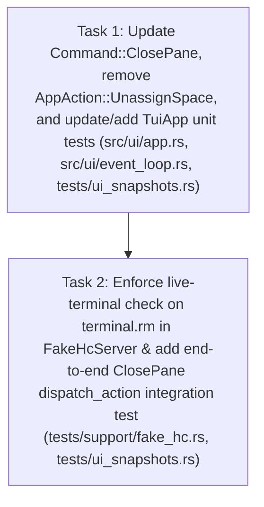

# Implementation Plan: `Command::ClosePane` (`Ctrl+b q` / `Ctrl+b x`) Kills and Removes Terminal in `hc`

## Overview
Currently in `htui`, `Command::ClosePane` (`src/ui/app.rs`) clears the focused pane's terminal reference, removes its attach session, strips the `"space"` label from `self.model.terminals.get_mut(&addr)`, and emits `AppAction::UnassignSpace(addr)`. In `src/ui/event_loop.rs`, `dispatch_action(AppAction::UnassignSpace(addr))` calls `client.terminal_label(&addr, {"space": null})`, leaving the terminal running headless in `hc` and moving it into `(unassigned)` in the sidebar. This plan changes `Command::ClosePane` to kill and remove the pane's terminal in `hc` (`AppAction::Kill(addr)` + `AppAction::Remove(addr)` for live or unknown-state terminals, and `AppAction::Remove(addr)` for already-finished terminals), removes `addr` cleanly from `app.model.terminals`, `app.sessions`, and `LayoutStore` without landing in `(unassigned)`, removes the now-unused `AppAction::UnassignSpace` variant, and verifies the full back-to-back `terminal.kill` -> `terminal.rm` flow against `FakeHcServer` and `LayoutStore`.

---

## Architecture Decisions

1. **Terminal State Classification in `Command::ClosePane` (`src/ui/app.rs`):**
   - Before mutating `self.model.terminals`, inspect `self.model.terminals.get(&addr)`:
     - **Already finished** (`Some(t)` with `!t.is_live()`, consistent with `Terminal::is_live()` in `src/hc/types.rs` and `Command::ConfirmRemove` in `src/ui/app.rs`): emit only `AppAction::Remove(addr)`.
     - **Live or unknown state** (`Some(t)` with `t.is_live()`, or `None` when `addr` is absent from `self.model.terminals`): emit `AppAction::Kill(addr.clone())` followed by `AppAction::Remove(addr)`.
   - **Immediate In-Memory Cleanup:** Replace `if let Some(t) = self.model.terminals.get_mut(&addr) { t.labels.remove("space"); }` with `self.model.terminals.remove(&addr);` (alongside `self.current_tree_mut().set_terminal(pid, None);` and `self.sessions.remove(&addr);`).
     - Rationale: `TuiApp::space_has_open_terminals` (`src/ui/app.rs:1011-1014`) checks `self.model.terminals.values().any(|t| t.is_live() && t.labels.get("space") == Some(space))`. Removing `addr` from `self.model.terminals` immediately ensures `space_has_open_terminals(&cur_space)` evaluates to `false` when closing a space's last terminal (so `RemoveLayout(cur_space)` is emitted cleanly) and ensures `self.refresh_sidebar()` never shows `addr` under `(unassigned)`.
   - Keep `Command::ConfirmKill` (`Ctrl+b K`) and `Command::ConfirmRemove` (`Ctrl+b R`) unchanged so explicit kill/remove commands continue to prompt via `ConfirmDialog` per `UI-5` and `UI-6` in `.orca/SPEC.md`.

2. **Back-to-Back `AppAction::Kill` + `AppAction::Remove` Dispatch (`src/ui/event_loop.rs`):**
   - Verified `dispatch_action` (`src/ui/event_loop.rs:540-575`):
     - `AppAction::Kill(addr)` calls `client.terminal_kill(&addr).await`, then removes `addr` from `app.sessions`, prunes spaces, and calls `app.model.terminals.remove(&addr)`.
     - `AppAction::Remove(addr)` calls `client.terminal_rm(&addr).await` directly with `addr` (without requiring `addr` to still be present in `app.model.terminals`), so running `Kill(addr)` followed by `Remove(addr)` works cleanly even though `ClosePane` and `AppAction::Kill` already removed `addr` from `app.model.terminals`.
     - Subsequent asynchronous `"finished"` / `"removed"` core events arriving in `handle_core_event` (`src/ui/event_loop.rs:373-405`) are idempotent no-ops when `addr` is already removed from `app.model.terminals`, `app.sessions`, and `app.layouts.spaces`.

3. **Remove Unused `AppAction::UnassignSpace` (`src/ui/app.rs`, `src/ui/event_loop.rs`):**
   - Repository-wide search confirms `AppAction::UnassignSpace` is only constructed in `Command::ClosePane` and handled in `dispatch_action` (plus assertions in `tests/ui_snapshots.rs`).
   - Remove `AppAction::UnassignSpace(String)` from `AppAction` in `src/ui/app.rs` and its match arm in `dispatch_action` (`src/ui/event_loop.rs`) to avoid dead code.

4. **Realistic `terminal.rm` Guard in `FakeHcServer` (`tests/support/fake_hc.rs`):**
   - Per `tests/fixtures/openrpc.json`, `hc`'s `terminal.rm` rejects `"live"` terminals with `-32000` / `{ "kind": "live" }`, while `FakeHcServer` (`tests/support/fake_hc.rs:549-560`) currently deletes any terminal regardless of `state`.
   - Update `FakeHcServer`'s `"terminal.rm"` handler to return the `"live"` RPC error when `st.terminals` contains `addr` with `state == "live"`. This guarantees the integration test genuinely proves `AppAction::Kill` transitions the terminal to `"finished"` before `AppAction::Remove` executes.

---

## Dependency Graph

---

## Task List

### Phase 1: `Command::ClosePane` Action & State Cleanup
- [x] Task 1: Update `Command::ClosePane` to emit `Kill`+`Remove` / `Remove`, clean `model.terminals`, remove `AppAction::UnassignSpace`, and update unit tests (`src/ui/app.rs`, `src/ui/event_loop.rs`, `tests/ui_snapshots.rs`)

### Checkpoint: Core `ClosePane` Semantics Verified
- [x] `cargo test --test ui_snapshots` and `cargo test --all-targets` pass
- [x] `cargo check --all-targets` succeeds with zero warnings

### Phase 2: End-to-End `FakeHcServer` Verification
- [x] Task 2: Enforce `live` check on `FakeHcServer`'s `terminal.rm` and add async `ClosePane` -> `dispatch_action` integration test (`tests/support/fake_hc.rs`, `tests/ui_snapshots.rs`)

### Checkpoint: Complete
- [x] All acceptance criteria met
- [x] `cargo test --all-targets`, `cargo fmt --all -- --check`, and `cargo clippy --all-targets -- -D warnings` pass cleanly

---

## Risks and Mitigations

| Risk | Impact | Mitigation |
|------|--------|------------|
| Existing tests in `tests/ui_snapshots.rs` (`close_last_terminal_removes_terminal_and_empty_space`, `close_pane_and_quit_cleanup_empty_spaces_and_unassigned_splits`) assert `AppAction::UnassignSpace` and `model.terminals.get("t1")` still existing | Med | Update both tests in Task 1 (TDD: update assertions first, observe failure, then implement) to assert `AppAction::Kill` + `AppAction::Remove`, `!app.model.terminals.contains_key("t1")`, and no `(unassigned)` sidebar entry |
| If `ClosePane` closes a pane whose terminal is absent from `model.terminals` (unknown state) AND already gone on `hc`, `AppAction::Kill` could receive `not_found` | Low | `AppAction::Remove` still executes immediately after `AppAction::Kill`; verify in Task 2 with `FakeHcServer` that live, finished, and unknown-state cases behave as expected |
| `FakeHcServer`'s `terminal.rm` previously allowed deleting `"live"` terminals without `terminal.kill`, which could mask a missing `AppAction::Kill` | Med | Update `FakeHcServer`'s `"terminal.rm"` in Task 2 to return `data.kind = "live"` when `state == "live"`, matching `openrpc.json` (checked all tests: no existing test calls `terminal.rm` on a live fake terminal) |
| Spec alignment: `UI-5` / `UI-6` require confirmation dialogs before killing/removing via kill/remove commands | Low | Keep `Command::ConfirmKill` (`Ctrl+b K`) and `Command::ConfirmRemove` (`Ctrl+b R`) modal dialogs intact; `Command::ClosePane` (`Ctrl+b x` / `Ctrl+b q`) directly kills/removes the closed pane's terminal per this task's explicit requirements |
