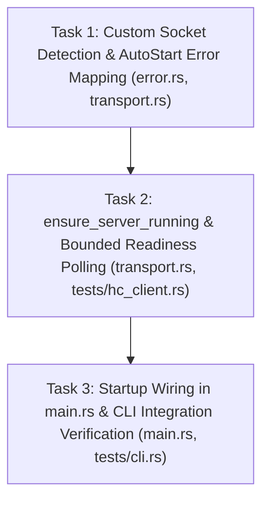

# Implementation Plan: `hc server start` Auto-Start on `htui` Startup

## Overview
When launching `htui` (default TUI mode or `htui open <space>`), `herdr-core` (`hc`) may not yet be running for the current session. This plan adds a pre-TUI auto-start check in `src/hc/transport.rs` and wires it into `src/main.rs` before terminal raw mode is enabled. If the target socket is the default core socket and is currently unreachable, `htui` spawns `hc server start` with null standard streams and polls for socket readiness with a bounded timeout before entering the TUI.

---

## Architecture Decisions

1. **Trigger Only on Default Socket & TUI Entry Paths (`htui` and `htui open`):**
   - *Rationale:* `hc server start` always binds the default session socket (`$XDG_RUNTIME_DIR/herdr-core/${HC_SESSION:-default}.sock`), not arbitrary paths passed via `--socket`, `HTUI_HC_SOCKET`, or `config.hc.socket`. Skipping auto-start when a custom socket override is active preserves test isolation (`FakeHcServer` and missing-socket tests) and satisfies `CL-4` (unreachable socket exits with code 3 for CLI commands).
2. **Execute Before `validate_space_exists` and Before `enable_raw_mode()`:**
   - *Rationale:* Running the check in `src/main.rs` before `validate_space_exists` (for `htui open`) and before `run_tui` ensures `htui open <space> --create` succeeds on a cold start and prevents any subprocess lifecycle issue from leaving the user's terminal in raw/alternate-screen mode.
3. **Probe Connectivity via `connect_unix` (Not `Path::exists`):**
   - *Rationale:* A crashed daemon may leave a stale Unix domain socket file on disk that refuses connections (`ECONNREFUSED`). Probing with `connect_unix(socket_path).await` accurately detects whether a live listener is accepting connections both before and during readiness polling.
4. **Detached Null-Stdio Spawn + Bounded Readiness Polling with Fast-Fail:**
   - *Rationale:* `hc server start` is spawned with `stdin(Stdio::null())`, `stdout(Stdio::null())`, and `stderr(Stdio::null())`. The readiness loop polls `connect_unix` every 50ms up to a bounded timeout (default 5s, configurable for tests). On each tick, `child.try_wait()` checks whether the process exited non-zero so bad invocations fail immediately without waiting out the full timeout, and kills/reaps the child if the timeout expires.
5. **Configurable `hc` Binary Override (`HTUI_HC_BIN` / Parameter Injection):**
   - *Rationale:* Accepting the executable path in `ensure_server_running_with` (defaulting to `HTUI_HC_BIN` env var or `"hc"`) allows deterministic integration testing of missing binaries, non-zero exits, timeouts, and delayed socket creation without mutating global `PATH` or touching a live user daemon.

---

## Dependency Graph

---

## Task List

### Phase 1: Transport Foundation & Readiness Polling
- [x] Task 1: Add custom socket detection helpers and auto-start error variant (`src/hc/error.rs`, `src/hc/transport.rs`)
- [x] Task 2: Implement `ensure_server_running` with bounded readiness polling and integration tests (`src/hc/transport.rs`, `tests/hc_client.rs`)

### Checkpoint: Transport Auto-Start Verified
- [x] `cargo test --lib hc::transport` and `cargo test --test hc_client` pass
- [x] Missing binary, non-zero exit, custom socket skip, and delayed socket bind are all covered by tests

### Phase 2: Entrypoint Wiring & End-to-End Verification
- [x] Task 3: Wire `ensure_server_running` into `src/main.rs` startup paths and verify CLI/TUI behavior (`src/main.rs`, `tests/cli.rs`)

### Checkpoint: Complete
- [x] All acceptance criteria met
- [x] `cargo test --all-targets`, `cargo fmt --all -- --check`, and `cargo clippy --all-targets -- -D warnings` pass
