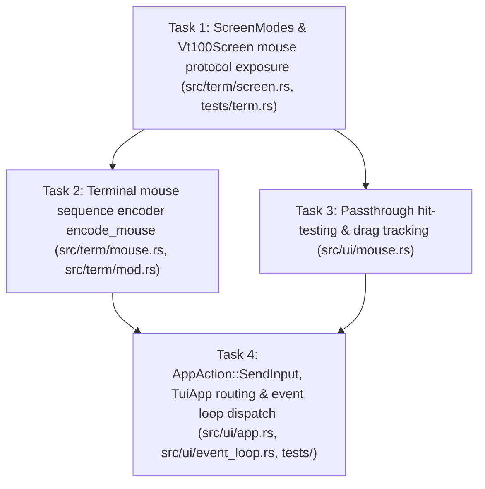

# Implementation Plan: Terminal Mouse Pass-Through in `htui`

## Overview
`htui` currently captures outer terminal mouse events via `crossterm::event::EnableMouseCapture` (which enables SGR 1006, 1000, 1002, 1003, and 1015 tracking) and routes all clicks, drags, and scroll events exclusively to multiplexer controls (`src/ui/mouse.rs` and `src/ui/app.rs`). As a result, mouse-enabled applications running inside a pane (such as `opencode`, `vim`, or `htop`) never receive mouse events. This plan adds terminal mouse protocol tracking on `ScreenModes`, implements an xterm mouse sequence encoder (`Sgr`, `Default`/X10, and `Utf8`), and updates mouse hit-testing and routing in `src/ui/mouse.rs`, `src/ui/app.rs`, and `src/ui/event_loop.rs` so active panes whose child requested mouse tracking receive 1-based pane-relative mouse sequences while preserving `htui` chrome controls and `Shift`-modified local fallback (selection and scrollback).

---

## Verified Crate APIs (`vt100` 0.15.2 & `crossterm` 0.28.1)

- **`vt100` 0.15.2 (`vt100::Screen`):**
  - `screen.mouse_protocol_mode() -> vt100::MouseProtocolMode` with variants `None`, `Press` (`?9h`), `PressRelease` (`?1000h`), `ButtonMotion` (`?1002h`), `AnyMotion` (`?1003h`).
  - `screen.mouse_protocol_encoding() -> vt100::MouseProtocolEncoding` with variants `Default` (X10/Normal), `Utf8` (`?1005h`), `Sgr` (`?1006h`).
- **`crossterm` 0.28.1:**
  - `EnableMouseCapture` already enables `?1000h`, `?1002h`, `?1003h`, `?1015h`, and `?1006h` in `src/ui/event_loop.rs`, so `Event::Mouse(MouseEvent)` already delivers `Down(btn)`, `Up(btn)`, `Drag(btn)`, `Moved`, `ScrollUp`, `ScrollDown`, `ScrollLeft`, and `ScrollRight` with 0-based `(column, row)` and `KeyModifiers`.

---

## Architecture Decisions

1. **Encapsulate `MouseProtocolMode` and `MouseProtocolEncoding` in `src/term/screen.rs`:**
   - *Rationale:* `ScreenModel` and `ScreenModes` intentionally hide `vt100` types behind `htui`-owned types (just as `map_vt100_color` maps `vt100::Color` to `ratatui::style::Color`). Defining `MouseProtocolMode` and `MouseProtocolEncoding` with `#[derive(Debug, Clone, Copy, PartialEq, Eq, Default)]` on `ScreenModes` preserves `ScreenModes::default()` compatibility across existing callers and keeps `ScreenModel` decoupled from `vt100`.

2. **Dedicated `src/term/mouse.rs` Encoder Module (`encode_mouse`):**
   - *Rationale:* Parallels `src/term/keys.rs` (`encode_key`, `encode_paste`) and avoids conflating PTY byte encoding with UI hit-testing in `src/ui/mouse.rs`.
   - *Mode Filtering:*
     - `None`: returns `None` for all events.
     - `Press` (`?9h`): encodes `Down(_)` only; drops `Up(_)`, `Drag(_)`, `Moved`, and scroll events.
     - `PressRelease` (`?1000h`): encodes `Down(_)`, `Up(_)`, `ScrollUp`, `ScrollDown`, `ScrollLeft`, `ScrollRight`; drops `Drag(_)` and `Moved`.
     - `ButtonMotion` (`?1002h`): `PressRelease` + `Drag(_)`; drops `Moved`.
     - `AnyMotion` (`?1003h`): `ButtonMotion` + `Moved`.
   - *Button, Motion, Modifier, and Coordinate Encoding:*
     - Converts 0-based pane-inner `(rel_col, rel_row)` to 1-based `(cx, cy) = (rel_col + 1, rel_row + 1)`.
     - Base button code: `Left = 0`, `Middle = 1`, `Right = 2`, `Moved = 3`, `ScrollUp = 64`, `ScrollDown = 65`, `ScrollLeft = 66`, `ScrollRight = 67`. Motion bit `32` (`0x20`) added for `Drag(_)` and `Moved`. Modifier bits: `SHIFT = 4`, `ALT = 8`, `CONTROL = 16`.
     - `Sgr`: `\x1b[<{cb};{cx};{cy}M` (or `m` for `Up(_)`), preserving the released button number (`0`/`1`/`2`) and supporting coordinates `> 223`.
     - `Default` (X10/Normal): `[0x1b, b'[', b'M', cb + 32, cx + 32, cy + 32]` with button `3` for `Up(_)`; returns `None` if `cx > 223 || cy > 223` to prevent `u8` wraparound.
     - `Utf8` (`?1005h`): `\x1b[M` followed by UTF-8 bytes of `char::from_u32(cb + 32)`, `char::from_u32(cx + 32)`, `char::from_u32(cy + 32)` (with button `3` for `Up(_)`), returning `None` if a scalar conversion fails.

3. **Pure Hit-Testing Priority + Active Passthrough Drag Tracking in `src/ui/mouse.rs`:**
   - *Rationale:* Preserves the existing `handle_mouse` signature (used by existing tests) while introducing `handle_mouse_with_passthrough(..., should_passthrough: impl Fn(PaneId) -> bool)` and `MouseAction::PaneMouse { pane_id, rel_col, rel_row }`.
   - *Active Drag Continuity:* Adding `active_passthrough_pane: Option<(PaneId, Rect)>` to `MouseDragState` ensures that once a passthrough `Down` starts inside an inner rect, subsequent `Drag` and `Up` events stay bound to that pane (clamped to `inner`) even if the cursor drifts onto a border or adjacent pane before button release, preventing stuck mouse-button state in `vim`/`opencode`.
   - *Priority Order:*
     1. Active `htui` drags (`drag.active_divider` or `drag.active_selection`) continue/finish first.
     2. Active passthrough drag (`drag.active_passthrough_pane`) handles `Drag`/`Up` and clears on `Up`.
     3. `Down(Left)`: `geom.dividers` (`hit_divider`) -> `sidebar_areas` -> `takeover_btn` / `spawn_btn` -> pane `inner` (`PaneMouse` if `should_passthrough`, else `StartSelect`) -> pane border `rect` (`FocusPane`).
     4. `Down(Middle | Right)`, `Up(_)`, `Drag(_)`, `Moved`, `ScrollUp`, `ScrollDown`, `ScrollLeft`, `ScrollRight`: if inside a pane's `inner` rect and `should_passthrough(pane_id)` -> `PaneMouse`; otherwise `ScrollUp`/`ScrollDown` fall back to `MouseAction::ScrollUp`/`ScrollDown` on `pane.rect`.

4. **Explicit `AppAction::SendInput` + Routing Guards in `src/ui/app.rs` & `src/ui/event_loop.rs`:**
   - *Rationale:* Emitting `AppAction::SendInput { terminal, bytes }` from `TuiApp::handle_mouse_event` and executing `sess.send_input(&bytes)` inside `dispatch_action` makes mouse pass-through unit-testable in `tests/ui_snapshots.rs` (without needing a live socket) and end-to-end testable via `FakeHcServer` in `tests/term.rs`.
   - *Routing Guards in `TuiApp::handle_mouse_event`:*
     - **Modal Guard:** When `self.dialog.is_some()`, return `Vec::new()` immediately so open modals block background pane pass-through, focus changes, and selections.
     - **Tab Bar:** Checked on `Down(Left)` when no divider/selection/passthrough drag is active.
     - **Passthrough Eligibility:** Only when the pane is attached, `sess.state == SessionState::Active` (not `Observing`, `Connecting`, `Ended`, or `Error`), `sess.screen.modes().mouse_mode != MouseProtocolMode::None`, and `!mouse.modifiers.contains(KeyModifiers::SHIFT)`.
     - **Focus vs Hover:** `MouseEventKind::Down(_)` focuses the target pane (`self.focused_pane = Some(pane_id)`, `self.sidebar_focused = false`, clears `self.selection`, sets `self.dirty = true`); `Moved`/`Scroll*`/`Drag`/`Up` forward without stealing pane focus or forcing redundant redraws when the PTY hasn't produced output.

---

## Dependency Graph

---

## Task List

### Phase 1: Terminal Protocol & Mouse Encoding
- [x] Task 1: Expose `MouseProtocolMode` and `MouseProtocolEncoding` on `ScreenModes` / `Vt100Screen` (`src/term/screen.rs`, `tests/term.rs`)
- [x] Task 2: Implement `encode_mouse` for SGR, Default (X10), and UTF-8 encodings with mode filtering (`src/term/mouse.rs`, `src/term/mod.rs`)

### Checkpoint: Terminal Layer Verified
- [x] `cargo test --lib term` and `cargo test --test term` pass
- [x] All DECSET/DECRST mouse modes and encodings are decoded and re-encoded accurately

### Phase 2: UI Hit-Testing, Routing & Dispatch
- [x] Task 3: Add `MouseAction::PaneMouse`, `active_passthrough_pane`, and `handle_mouse_with_passthrough` (`src/ui/mouse.rs`)
- [x] Task 4: Add `AppAction::SendInput`, modal/tab/shift/observing routing in `TuiApp::handle_mouse_event`, and `dispatch_action` wiring (`src/ui/app.rs`, `src/ui/event_loop.rs`, `tests/ui_snapshots.rs`, `tests/term.rs`)

### Checkpoint: Complete
- [x] All acceptance criteria met
- [x] `cargo test --all-targets`, `cargo fmt --all -- --check`, and `cargo clippy --all-targets -- -D warnings` pass

---

## Risks and Mitigations

| Risk | Impact | Mitigation |
|------|--------|------------|
| Drag release (`Up`) occurs outside pane inner rect after `Down` inside a mouse-tracking pane, leaving child app stuck in pressed state | High | Track `active_passthrough_pane: Option<(PaneId, Rect)>` in `MouseDragState` and clamp `Drag`/`Up` coordinates to `inner` until `Up` clears it |
| `Drag` or `Moved` arrives when child only enabled `PressRelease` (`?1000h`) and leaks into `htui` text selection | High | Match `should_passthrough` on `mouse_mode != None`; `encode_mouse` drops unrequested `Drag`/`Moved` (`None`) without falling back to `htui` selection |
| Split divider `+/- 1` cell tolerance overlaps column 0 of right/bottom pane | Med | Keep `hit_divider` ahead of pane inner rect on `Down(Left)` so split dividers remain owned by `htui` per spec |
| `Default` (X10) encoding overflows `u8` for panes wider/taller than 223 columns/rows | Med | Explicitly guard `cx > 223 || cy > 223` and return `None` instead of wrapping `u8` |
| Open modal dialog allows background clicks or mouse motion to reach underlying panes | Med | Guard `TuiApp::handle_mouse_event` with an early return when `self.dialog.is_some()` |
