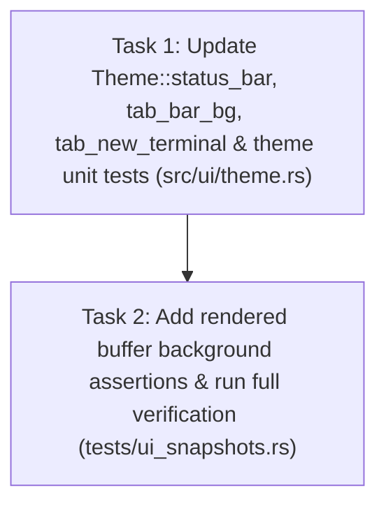

# Implementation Plan: Inherit App Background for Panel Tab Bar & Footer Status Bar

## Overview
Currently in `htui`, the main application surfaces—sidebar (`src/ui/sidebar.rs`), split panes (`src/ui/panes.rs`), and modal dialogs (`src/ui/dialogs/*`)—use `Style::default()` / `Block::default()` without a background color (`bg: None`, rendering with the terminal's default `Color::Reset` background). By contrast, `Theme::status_bar()`, `Theme::tab_bar_bg()`, and `Theme::tab_new_terminal()` in `src/ui/theme.rs` explicitly apply `.bg(Self::SUMI_INK0)` (`Color::Rgb(22, 22, 29)`), causing the panel tab bar row and the footer status bar to render with a near-black bar instead of inheriting the app background. This plan removes `.bg(Self::SUMI_INK0)` from those three theme styles so both the panel tab bar and footer inherit the app background (`bg: None` / `Color::Reset` in the rendered buffer), while preserving readable contrast for active/inactive tab pills and separators, and updates/adds unit and snapshot tests to verify the behavior.

---

## Architecture Decisions

1. **Main App Background Convention (`src/ui/app.rs`, `src/ui/sidebar.rs`, `src/ui/panes.rs`, `src/ui/dialogs/mod.rs`):**
   - `TuiApp::render` does not paint a global background color; `render_sidebar`, `render_panes`, and dialogs rely on `Style::default()` (`bg: None`), which leaves ratatui buffer cells at `Color::Reset` (the host terminal's background).
   - Matching this convention requires `bg: None` on the tab bar and footer styles rather than introducing a hardcoded `Color::Rgb` fill.

2. **Theme Style Updates (`src/ui/theme.rs`):**
   - **`Theme::status_bar()`**: Change from `Style::default().bg(Self::SUMI_INK0).fg(Self::OLD_WHITE)` to `Style::default().fg(Self::OLD_WHITE)` (`bg: None`). `render_statusbar` (`src/ui/statusbar.rs`) applies this style to `Paragraph`, so the footer inherits the app background.
   - **`Theme::tab_bar_bg()`**: Change from `Style::default().bg(Self::SUMI_INK0).fg(Self::SUMI_INK4)` to `Style::default().fg(Self::SUMI_INK4)` (`bg: None`). In `render_tab_bar` (`src/ui/tabs.rs`), this styles both the empty tab-bar cells and the `"│"` separators between tabs, matching `Theme::border_normal()` (`fg: SUMI_INK4, bg: None`) on the app background.
   - **`Theme::tab_new_terminal()`**: Change from `Style::default().fg(Self::WAVE_AQUA2).bg(Self::SUMI_INK0).add_modifier(Modifier::BOLD)` to `Style::default().fg(Self::WAVE_AQUA2).add_modifier(Modifier::BOLD)` (`bg: None`), so `" [+ New Terminal] "` sits cleanly on the inherited app background without a black box.
   - **`Theme::tab_active()` & `Theme::tab_inactive()`**: Keep `tab_active()` (`fg: SUMI_INK0, bg: CRYSTAL_BLUE, BOLD`) and `tab_inactive()` (`fg: OLD_WHITE, bg: SUMI_INK3`) intact. `SUMI_INK3` (`Rgb(54, 54, 70)`) is a subtle charcoal pill (not `SUMI_INK0` black) that maintains readable `OLD_WHITE` contrast on any terminal background and visually distinguishes inactive tab pills from the open tab bar and the active `CRYSTAL_BLUE` tab pill.
   - Keep `SUMI_INK0` intact as a palette constant and foreground color for `badge_active()`, `badge_observing()`, and `tab_active()`.

3. **Test Coverage (`src/ui/theme.rs`, `tests/ui_snapshots.rs`):**
   - Update `kanagawa_wave_palette_styles` in `src/ui/theme.rs` (currently asserting `Theme::status_bar().bg == Some(Theme::SUMI_INK0)`) to assert `bg == None` for `status_bar()`, `tab_bar_bg()`, and `tab_new_terminal()`, while asserting pill backgrounds (`CRYSTAL_BLUE` / `SUMI_INK3`) and foreground colors remain intact.
   - Add rendered buffer assertions in `tests/ui_snapshots.rs` verifying via `TuiApp::render` (and/or `render_tab_bar` + `render_statusbar`) that empty tab-bar cells, `"│"` separators, `"[+ New Terminal]"`, and the footer status bar all share `Color::Reset` background with the sidebar/pane frames (`!= Theme::SUMI_INK0`), while active/inactive tab pills retain `Theme::CRYSTAL_BLUE` and `Theme::SUMI_INK3`.

---

## Dependency Graph

---

## Task List

### Phase 1: Theme Styles & Rendered Verification
- [x] Task 1: Update `Theme::status_bar()`, `Theme::tab_bar_bg()`, `Theme::tab_new_terminal()`, and `kanagawa_wave_palette_styles` (`src/ui/theme.rs`)
- [x] Task 2: Verify rendered tab bar & footer background inheritance in `TuiApp::render` snapshots (`tests/ui_snapshots.rs`)

### Checkpoint: Complete
- [x] All acceptance criteria met
- [x] `cargo test --all-targets`, `cargo fmt --all -- --check`, and `cargo clippy --all-targets -- -D warnings` pass cleanly

---

## Risks and Mitigations

| Risk | Impact | Mitigation |
|------|--------|------------|
| Existing test `kanagawa_wave_palette_styles` in `src/ui/theme.rs` explicitly asserts `Theme::status_bar().bg == Some(Theme::SUMI_INK0)` | Low | Update the assertion in Task 1 to `None` alongside explicit assertions for `tab_bar_bg().bg`, `tab_new_terminal().bg`, `tab_active()`, and `tab_inactive()` |
| `tab_new_terminal()` (`WAVE_AQUA2`) or `status_bar()` (`OLD_WHITE`) contrast on unusual light terminal themes | Low | Keep `tab_inactive()` (`OLD_WHITE` on `SUMI_INK3` pill) and `tab_active()` (`SUMI_INK0` on `CRYSTAL_BLUE` pill) untouched, and keep `fg(OLD_WHITE)` / `fg(WAVE_AQUA2)` matching the rest of the Kanagawa Wave app palette (`sidebar.rs`, `panes.rs`) |
| Stale background cells if a caller ever reuses a non-empty `Buffer` | Low | `Terminal::draw` and `Buffer::empty` initialize cells to `Color::Reset`, matching how `render_sidebar` and `render_panes` work across the app |
